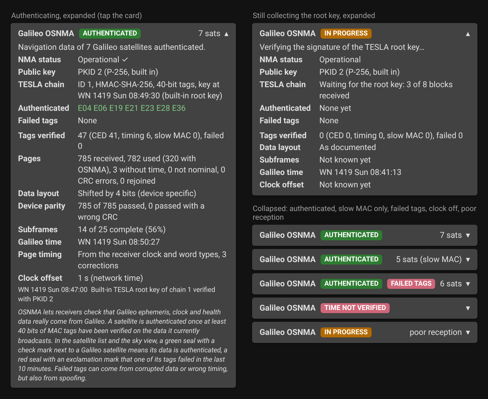
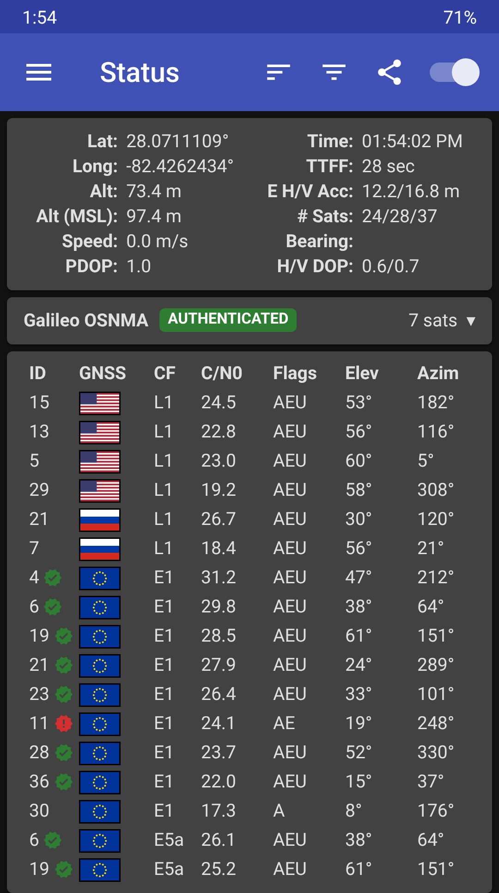

# Galileo OSNMA

GPSTest can verify Galileo Open Service Navigation Message Authentication
([OSNMA](https://www.gsc-europa.eu/galileo/services/galileo-open-service-navigation-message-authentication-osnma)).
OSNMA lets a receiver check that the ephemeris, clock and health data broadcast by Galileo
satellites really comes from Galileo and hasn't been forged by a spoofer.

GPSTest does all the cryptography on the phone, from the Galileo E1-B I/NAV navigation messages
that Android delivers to apps. The result is shown on the **Status** screen.



*Mockup of the card. The numbers in the left screen come from a real receiver recording.*



*The card in place on the Status screen (dark theme, mockup based on a store screenshot).*

## Requirements

- A device that provides Galileo navigation messages to apps (`GnssNavigationMessage` of type
  `TYPE_GAL_I`). Many don't. Check "Navigation Messages" under *What GNSS features does my
  device support?* in the [FAQ](FAQ.md). The OSNMA card appears once such messages arrive, and right away on later starts.
- Galileo satellites in view, ideally with a clear sky. Authentication starts after a few
  minutes of continuous reception.
- A correct device clock (within 30 seconds). See [Limitations](#limitations).

## The Status card

| Field | Meaning |
| --- | --- |
| Status chip | **AUTHENTICATED** (green): navigation data is being verified. **IN PROGRESS** (amber): waiting for the public key, the TESLA root key or the first tags. **NO DATA** (gray): no OSNMA data yet. **DON'T USE**, **ALERT**, **TIME NOT VERIFIED** and **FAILED TAGS** (red): see below. |
| NMA status | Operational, Test or Don't use, as broadcast by Galileo. A ✓ means it was confirmed by a verified signature. |
| Public key | The ECDSA public key ID (PKID), its curve and where it came from: *built in*, *from signal*, *Merkle tree file* or *imported*. |
| TESLA chain | Chain ID, MAC function, tag size and time of the latest verified TESLA key. |
| Authenticated | Satellites whose current ephemeris, clock and health data is authenticated. That means at least 40 bits of MAC tags were verified on the data the satellite is broadcasting right now. |
| Failed tags | Satellites with a tag that failed verification in the last 10 minutes, with the count. |

The card is a single line by default: the status chip and, while authenticating, the number of
authenticated satellites. Tap it to expand: the fields above, tag counts by type (CED, timing,
slow MAC), page counters (received, used, without time, not nominal, CRC errors), device parity,
subframe completeness, page timing, clock offset and the latest events.

### Satellite list and sky view

Galileo satellites are marked in the satellite list on the Status screen (next to the ID) and in
the sky view (at the upper right of the triangle):

- **Green closed lock**: the satellite's ephemeris, clock and health data is authenticated.
- **Red open lock**: a tag of this satellite failed in the last 10 minutes.

### Warning notification

When a tag fails, GPSTest posts a notification ("Galileo authentication failed") naming the
satellites, at most once every 10 minutes. It has its own notification channel, *Galileo OSNMA
warnings*, so it can be turned off in Android's notification settings without affecting the
tracking notification.

### Red states

- **FAILED TAGS**: a MAC tag didn't match the received navigation data. This can be caused by
  corrupted data or timing problems, but also by spoofing. Treat data from those satellites as
  untrusted.
- **TIME NOT VERIFIED**: the device clock differs from the Galileo time in the signal by more
  than 30 s. OSNMA can't detect replayed or delayed signals without an independent time source,
  so check the date and time settings.
- **DON'T USE**: Galileo has set the OSNMA status to "don't use". Nothing is authenticated
  until that changes.
- **Amber reception hint**: Galileo pages arrive, but fewer than half of the 30-second subframes
  are complete, or the pages stopped while tracking. Each satellite's authentication data needs
  all 15 pages of a subframe, so authentication becomes slow or stops. This is usually the chip
  saving power (duty cycling) or tracking only the E1 pilot signal, which carries no data. Keep
  **Force full GNSS measurements** on (Android 12 and later), keep the screen on, and give the
  phone a clear view of the sky. The share of complete subframes is shown in the details.
- **ALERT**: an authenticated OSNMA Alert Message was received. All keys, including the built-in
  Merkle tree root, are no longer trusted. Import new key material from the GSC to resume.

## Keys

OSNMA needs the Galileo ECDSA public key to verify the TESLA root key. Nothing has to be set up:

1. **Built in.** GPSTest ships with the current Galileo public key (PKID 2) and the Merkle tree
   root. The key is only used after its Merkle tree path is checked against the root, so
   authentication starts within minutes of the first fix.
2. **From the signal.** When Galileo introduces a new key, it broadcasts it every 6 hours (at 00,
   06, 12 and 18 h Galileo time). GPSTest verifies it against the Merkle tree root and stores it,
   so new keys are picked up without an app update.
3. **Imported (optional).** Only needed if the Merkle tree itself changes, or after an alert
   message. Download the files from the
   [European GNSS Service Centre](https://www.gsc-europa.eu/gsc-products/OSNMA/PKI) (free
   registration) and import one under **Settings > Galileo OSNMA > Import OSNMA public key or
   Merkle tree**. Supported files:
   - `OSNMA_MerkleTree_*.xml`: replaces the Merkle tree root. The public key it contains is
     verified against that root before use.
   - `OSNMA_PublicKey_*.xml`
   - `OSNMA_PublicKey_*.crt` or a PEM public key. The PKID is taken from the file name
     (`…PKID_2…`).

**Forget OSNMA keys** deletes the stored public keys, any imported Merkle tree, the saved TESLA
key and the saved parts of the TESLA root key. The built-in key stays.
**Authenticate Galileo navigation data** turns the feature off.

## What is verified

GPSTest follows the
[OSNMA SIS ICD v1.1](https://www.gsc-europa.eu/sites/default/files/sites/all/files/Galileo_OSNMA_SIS_ICD_v1.1.pdf)
and the OSNMA Receiver Guidelines:

- I/NAV page CRC (CRC-24Q)
- DSM-PKR: public keys against the Merkle tree root
- DSM-KROOT: ECDSA P-256/SHA-256 or P-521/SHA-512 signature of the TESLA root key
- TESLA key chain (SHA-256 or SHA3-256), MACSEQ and the MAC look-up table
- MAC tags (HMAC-SHA-256 or CMAC-AES) for ADKD 0 (ephemeris, clock and health), ADKD 4
  (timing parameters) and ADKD 12 (slow MAC)
- Chain renewal and revocation, public key renewal and revocation, alert messages

The engine is in `library/src/main/java/com/android/gpstest/library/osnma`. It's pure Kotlin
without Android or third-party dependencies, and is modelled on the
[galileo-osnma](https://github.com/daniestevez/galileo-osnma) Rust library. It produces the
same results as galileo-osnma, tag for tag, on all
[GSC OSNMA test vector](https://www.gsc-europa.eu/support-to-developers/osnma-test-vectors)
scenarios and on a real receiver recording. The unit tests in
`library/src/test/java/com/android/gpstest/library/osnma` run on a trimmed test vector:

```
./gradlew :library:testDebugUnitTest --tests "com.android.gpstest.library.osnma.*"
```

## Limitations

- **Only the navigation messages are authenticated.** GPSTest can't tell whether the device's
  own position fix used authenticated data. The chipset computes the fix independently.
- **Time comes from the signal.** Android doesn't provide the Galileo time of each page, so
  GPSTest reads it from the I/NAV words and the arrival times. It's compared with the device
  clock, which must be correct for authentication to be meaningful (see *TIME NOT VERIFIED*).
  Like any OSNMA receiver without a secure time source, it can't detect all replay or delay
  attacks.
- **Data must be complete.** A satellite is only authenticated once all the words covered by
  its tags have been received, so weak or intermittent signals can delay it.
- **Devices that skip the CRC bits.** If the CRC fails on practically every page while the device
  says they passed its parity check, GPSTest assumes the device doesn't fill in the CRC bits,
  uses the device's check instead and says so in the details. Some devices mark every page as
  passed, damaged or not, so this fallback is only used when no page at all passes the CRC.

## Speeding things up

OSNMA was designed for receivers that see every page. Phones often don't, so GPSTest uses the
OSNMA messages page by page instead of waiting for complete 30 s subframes:

- **TESLA root key assembled across satellites.** All satellites broadcast the same DSM-KROOT
  message. Each of its bytes needs to arrive only once, from any satellite and any repetition.
  The result is accepted only if its ECDSA signature is valid.
- **TESLA keys from several satellites.** All satellites transmit the same TESLA key in a
  subframe, so it's put together from the pages of any of them. When keys of some subframes
  are missing, they're derived from the next verified key, so those subframes' tags aren't lost.
- **Tags from partial MACK messages.** Each tag is checked as soon as its own pages have arrived.
  The MACSEQ, which protects the flexible tags, is checked when its pages are there; without it,
  flexible tags are skipped. Fixed tags are checked against the MAC look-up table as usual.
- **Warm start.** The last verified TESLA key is saved. On the next start, new keys are verified
  by hashing back to it, so authentication can start within about a minute, without waiting for
  the root key. The saved key is dropped as soon as the signal shows a different chain in force,
  a revoked chain or key, an alert message, or a "don't use" status, and when keys are forgotten
  in the settings. The details then show the TESLA chain as "(from the previous session)".
- **Root key parts kept between sessions.** The parts of the TESLA root key (DSM-KROOT) and of
  public key messages received so far are saved every minute and when tracking stops. The next
  session continues collecting where the last one stopped, which matters on phones that miss
  most pages. Saved parts older than 3 days are ignored. They can't do harm: a message is only
  used once its signature or Merkle tree path checks out, and if the check fails, the saved
  parts are dropped and the message is collected again from the signal.

On the GSC test data with pages dropped at random, authentication still works when most pages
are missing (24 satellites at 30 % loss, 17 satellites at 70 % loss), where complete subframes
practically never occur. Pages whose timing is ambiguous aren't used for OSNMA data, so a page
in the wrong slot can't make a tag fail.

## Device quirks

Real phones don't always deliver Galileo I/NAV pages the way the Android documentation
describes. GPSTest detects and works around these differences. Each one is shown in the
expanded card.

### Bit layout of `TYPE_GAL_I` data

The
[`GnssNavigationMessage`](https://developer.android.com/reference/android/location/GnssNavigationMessage)
documentation says that a Galileo I/NAV page (2 x 114 bits, sync and tail removed) is packed
into 29 bytes, MSB first, with the 4 unused bits at the end ("skip B229-B232"):

```
documented:  [ 228 page bits ............................. ][ 4 unused ]
seen:        [ 4 unused ][ 228 page bits ............................. ]
```

A Pixel 8 Pro (Android 17) puts the 4 unused bits at the start instead, so the whole page is
shifted by 4 bits. Read the documented way, almost every field is garbage: the CRC fails, most
pages look "not nominal", and the word type and time stamps decode to nonsense (for example a
week number of 2904 instead of 1418). Read with the 4-bit offset, every page in a recorded log
was nominal and passed the CRC.

`InavLayoutDetector` checks each message with both layouts and uses the one under which the
page passes the CRC. Once a few pages pass with one layout and none with the other, that layout
is adopted. The **Data layout** row in the details shows the result ("As documented" or
"Shifted by 4 bits").

On that device, `getMessageId()` was mostly -1 and `getSubmessageId()` held the word type,
which matches the documentation for `submessage_id` ("the word type").

### Page halves paired the wrong way

A nominal page is an even page part followed by an odd page part. If a device reports the odd
part of one page together with the even part of the next, GPSTest rejoins the halves of two
consecutive messages from the same satellite, and keeps the result only if the CRC passes. The
**rejoined** count in the page counters shows how often this happened.

### Missing pages

Phones often deliver only part of the pages: the chip saves power (duty cycling) or tracks the
E1 pilot signal, which carries no data. The Pixel 8 Pro log contained only 7 to 32 % of each
Galileo satellite's pages. With complete subframes only, authentication couldn't complete at
such rates; with the page-by-page processing above it can, but it takes longer, mostly until all
parts of the TESLA root key have been received once. The **Subframes** row shows how many subframes were
complete, and the card shows a hint when fewer than half are. Turning on **Force full GNSS
measurements**, both in GPSTest's settings and in Android's developer options, and keeping the
screen on can help.

### Time of each page

Android doesn't say when a page was transmitted. GPSTest takes the Galileo time from the words
that carry it (word types 0, 5 and 6) and places other pages in the slot their word type occupies
in the fixed E1-B subframe sequence. This tolerates delivery delays of several seconds. Pages
that fail the CRC are never used for timing. The **Page timing** and **Clock offset** rows show
how this is going.

On devices that provide raw GNSS measurements, the receiver's own clock (`GnssClock`, Android 10
and later) gives the GNSS time at a known moment. GPSTest then estimates each page's time from
its arrival, without waiting for the first time stamp in the data, and only uses the word type
to settle on the exact slot. **Page timing** then says "From the receiver clock". The Galileo
time read from the signal is still compared with the device clock.

## Logging

With **Settings > Logging and Output > File Output > Galileo OSNMA** turned on (off by default), GPSTest
writes the OSNMA result to the CSV log file every 30 seconds, one record per satellite that
sends OSNMA data:

```
OSNMA,UnixTimeMillis,GstWeek,GstTimeOfWeekSeconds,Phase,NmaStatus,ChainId,PublicKeyId,Svid,CedAuthenticated,CedAuthBits,TimingAuthenticated,TimingAuthBits,TagsOk,TagsFailed
```

`Phase` is the overall state (for example `WAITING_FOR_KROOT` or `AUTHENTICATING`). Before any
satellite sends OSNMA data, a single record with empty satellite fields is written. To record
the raw pages too, turn on **Navigation messages** in the same category.
